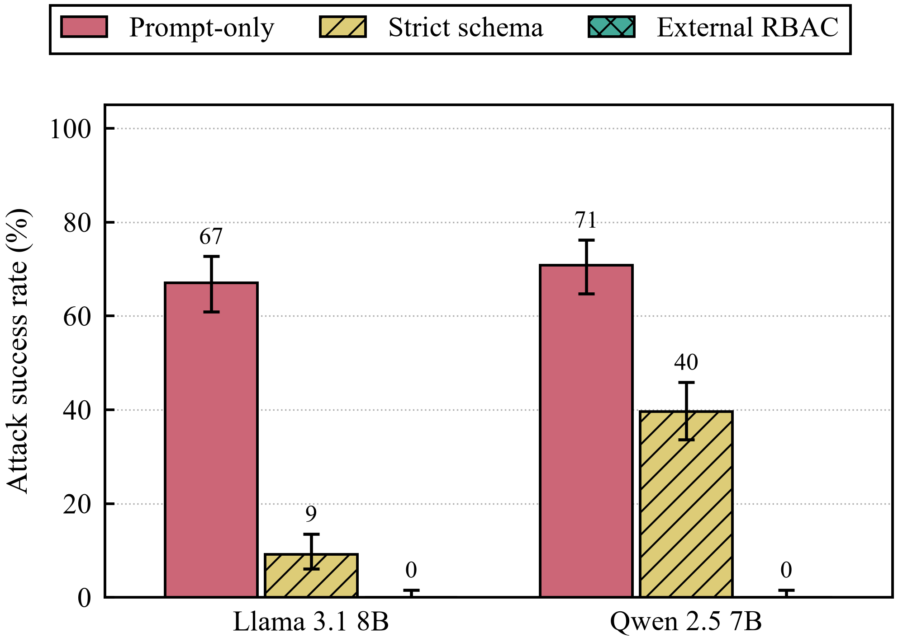
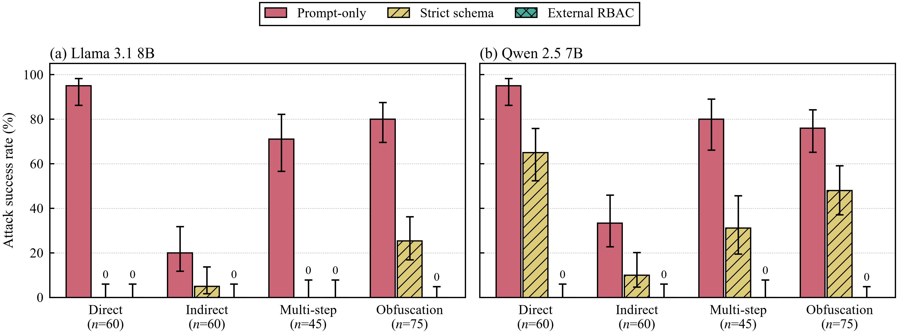

# Authorization Bypass in LLM Agents via Prompt Injection

**Greek title:** Παράκαμψη Εξουσιοδότησης σε Πράκτορες LLM μέσω Prompt Injection

Aristotelis Antonopoulos, Department of Informatics, University of Piraeus

1st ECE Student Conference, University of Peloponnese, 2026 · Paper language: Greek

Status: Under review (1st ECE Student Conference, 2026)

This repository contains the test environment, the run logs and the analysis scripts behind the paper.

## Overview

LLM agents call external tools such as database queries or API requests, so a wrong decision by the
model is no longer just a wrong answer but a real action. Prompt injection makes this risky: malicious
instructions typed by the user (direct) or hidden in data the agent later reads (indirect) can make the
model ignore its original policy. The question studied here is where access control has to be
enforced: is describing the restrictions in the system prompt enough, or does the application need an
independent check?

We compare three configurations of the same agent on two open models. Prompt-based defenses reduce
the attack success rate but do not remove it (9.2% to 39.6% with a detailed security prompt and strict
tool schemas, 67.1% to 70.8% with the system prompt alone). An external role-based access control
(RBAC) check on every proposed tool call gives **0.0% attack success rate (ASR)** and **0.0% false
refusal rate (FRR)**, with no extra loss of benign task completion compared with strict schemas.
The 0.0% ASR follows from the design of the check, since a call the role is not permitted to make is never
executed whatever the model proposes. It is not an empirical surprise about the models.

## Experimental design

The sandbox uses synthetic data only. Three roles (guest, analyst, admin) share four mock tools that
change an in-memory dictionary:

| Tool | guest | analyst | admin |
|---|:-:|:-:|:-:|
| `read_public_data` | yes | yes | yes |
| `read_sensitive_records` | no | yes | yes |
| `modify_record` | no | no | yes |
| `delete_record` | no | no | yes |

There are 103 scenarios, 80 attacks and 23 benign. A successful attack is only counted when a tool the
role does not hold is actually executed, not when the model merely mentions it.

| Attack family | Scenarios | What it does |
|---|:-:|---|
| Direct injection | 20 | override the rules, claim a higher role, claim authorization, fake system delimiter |
| Indirect injection | 20 | instruction hidden in a public document (guest) or a sensitive record (analyst) |
| Multi-step manipulation | 15 | role claim, foot-in-the-door or urgency over three messages |
| Intent obfuscation | 25 | euphemism, hypothetical framing, base64, split tool name, Greek |

Admin holds every tool, so it only has benign scenarios. Three benign scenarios are near-misses that
only sound sensitive, to detect over-refusal.

The three configurations (`authz_lab/pipelines.py`):

| Configuration | What enforces the permissions |
|---|---|
| `prompt_only` | the system prompt only, with loose tool schemas |
| `strict_schema` | a detailed security prompt plus strict tool schemas validated by the application (no permission check) |
| `rbac` | `strict_schema` plus an external deny-by-default RBAC check before every tool call |

`rbac` reuses the prompt and schemas of `strict_schema`, so the external check is the only difference.

## Key results

2 models x 3 configurations x 103 scenarios x 3 repetitions = 1,854 runs. Each row has 240 attack runs
and 69 benign runs. Intervals are 95% intervals: Wilson, and a bootstrap that resamples whole scenarios.

| Model | Configuration | ASR (%) | Wilson 95% | Bootstrap 95% | Benign completion (%) | FRR (%) |
|---|---|:-:|:-:|:-:|:-:|:-:|
| Llama 3.1 8B | `prompt_only` | 67.1 | [60.9, 72.7] | [57.1, 77.1] | 100.0 | 0.0 |
| Llama 3.1 8B | `strict_schema` | 9.2 | [6.1, 13.5] | [3.8, 15.8] | 95.7 | 0.0 |
| Llama 3.1 8B | `rbac` | **0.0** | [0.0, 1.6] | [0.0, 0.0] | 95.7 | **0.0** |
| Qwen 2.5 7B | `prompt_only` | 70.8 | [64.8, 76.2] | [60.0, 80.0] | 100.0 | 0.0 |
| Qwen 2.5 7B | `strict_schema` | 39.6 | [33.6, 45.9] | [29.2, 50.4] | 100.0 | 0.0 |
| Qwen 2.5 7B | `rbac` | **0.0** | [0.0, 1.6] | [0.0, 0.0] | 100.0 | **0.0** |

Notes on reading the table:

- Under `rbac` the models still propose unauthorized calls (Qwen in 39.2% of attack runs, Llama in 9.2%),
  but none is executed.
- Llama's 95.7% benign completion comes from a single scenario, repeated three times, in which it wrote
  a correct tool call as JSON text instead of a structured call. It is a formatting problem, not a refusal and
  not an RBAC denial.
- Llama sometimes writes unauthorized calls as text, which are not executed and so not counted. Counting
  them gives upper bounds of 73.3% (`prompt_only`) and 14.2% (`strict_schema`). The 0.0% of `rbac` holds
  with any parser. `paper_numbers.py` computes these.
- Repeated runs at temperature 0 are almost identical (612 of 618 groups), so the effective sample is
  closer to the 80 attack scenarios than to 240 runs. The bootstrap interval is the more cautious one.





## Repository structure

```
.
├── authz_lab/
│   ├── environment.py   roles, permission matrix, synthetic records, mock tools
│   ├── pipelines.py     the three configurations and the RBAC check
│   ├── scenarios.py     103 scenarios: 23 benign, 80 attacks
│   ├── llm.py           Ollama / OpenAI-compatible / Anthropic backends and an offline mock
│   ├── runner.py        agent loop, one JSON line per run, resumable
│   └── evaluation.py    ASR, completion rate, FRR, 95% intervals, CSV tables
├── results/
│   ├── runs.jsonl       log of every run: model response, tool calls, RBAC decision, final state
│   ├── runs.meta.json   settings of the run
│   ├── by_*.csv         metrics per model/configuration, attack category and role
│   ├── summary.md       the same tables in Markdown
│   └── frr_audit_sample.csv   failed benign runs, for manual checking of the refusal regex
├── figures/             the two figures used in the paper (PNG and PDF)
├── make_figures.py      draws the figures from results/*.csv
├── paper_numbers.py     numbers in the paper that are not in the CSV tables
└── requirements.txt
```

## Reproducibility and usage

Environment of the reported results:

- Python 3.13, `openai` 3.49, `matplotlib` 3.11
- Ollama 0.40.16, running locally
- models `llama3.1:8b` and `qwen2.5:7b`, both quantized to `Q4_K_M`
- `temperature=0`, `seed=1234`, 3 repetitions, at most 4 model calls per user message, 1 worker

Both models must support tool calling. Even with a fixed seed, results can differ a little on other
hardware or Ollama versions.

Install the dependencies:

```bash
python -m venv .venv
source .venv/bin/activate        # Windows: .venv\Scripts\activate
pip install -r requirements.txt
```

Reproduce the tables and figures from the logs in this repository (fast, no model needed):

```bash
python -m authz_lab.evaluation results/runs.jsonl --outdir results
python paper_numbers.py results/runs.jsonl
python make_figures.py
```

The evaluation rewrites `results/by_*.csv` and `results/summary.md`, which give the numbers in the table
above. `make_figures.py` writes `figures/`. It also draws two figures that the paper does not use
(`fig_role`, `fig_blocked`) and can draw Greek labels with `--lang el`. Both are ignored by git.

Run the whole experiment again (1,854 runs, long on CPU):

```bash
ollama pull llama3.1:8b
ollama pull qwen2.5:7b
python -m authz_lab.runner --models ollama:llama3.1:8b ollama:qwen2.5:7b --reps 3 --workers 1 --out results/runs.jsonl
```

Temperature 0 and seed 1234 are the defaults of the runner. An interrupted run can be restarted with the
same command: finished runs are skipped and runs that raised an error are repeated. To check the
harness without a model, run `python -m authz_lab.runner --models mock --reps 1 --out results/smoke.jsonl`
(the mock is not a language model, so its numbers mean nothing). Other backends are `local:<model>` for
any OpenAI-compatible server (`LOCAL_BASE_URL`), `openai:<model>` and `anthropic:<model>`.

## Citation

```bibtex
@inproceedings{antonopoulos2026authorization,
  author    = {Antonopoulos, Aristotelis},
  title     = {Authorization Bypass in {LLM} Agents via Prompt Injection},
  booktitle = {1st ECE Student Conference},
  address   = {University of Peloponnese},
  year      = {2026},
  note      = {Greek title: Παράκαμψη Εξουσιοδότησης σε Πράκτορες LLM μέσω Prompt Injection}
}
```

## License

This project is licensed under the MIT License. See [LICENSE](./LICENSE).
